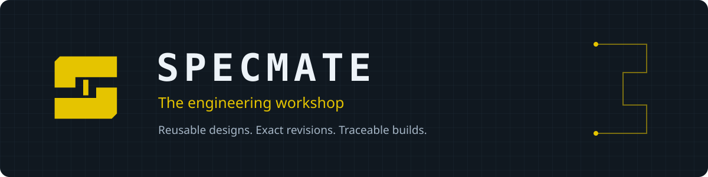
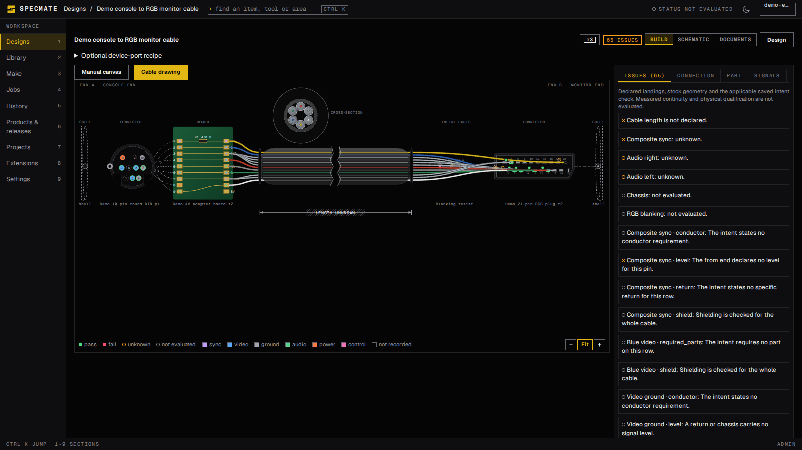
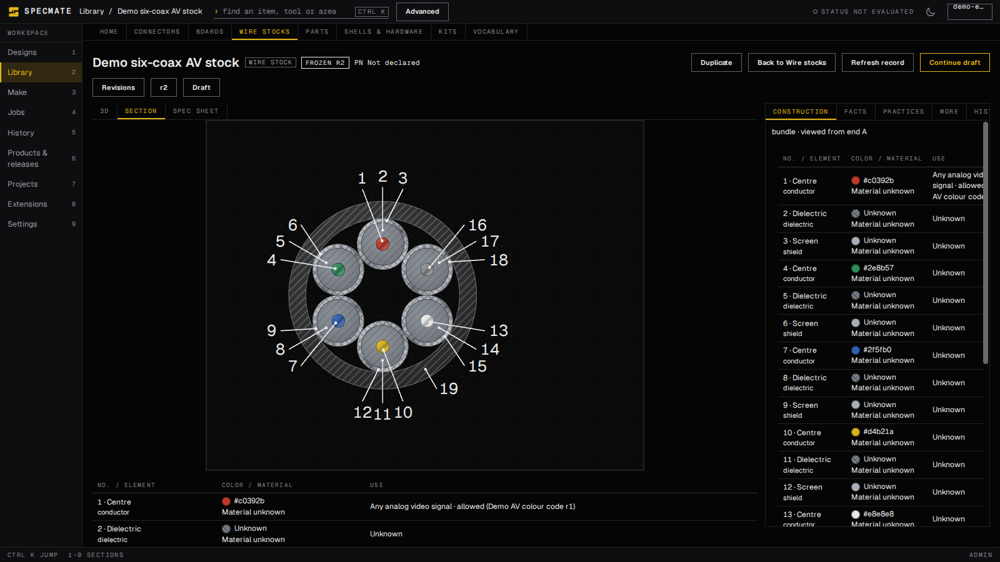
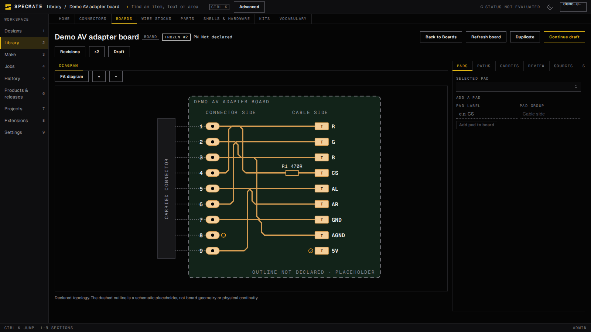

<p align="center"></p>

A self-hosted engineering workshop for reusable parts, boards, cables, enclosures,
firmware, assemblies, and the physical things built from them.

Define an item once. Pin its exact revision wherever it is used. Carry its sources,
identity and evidence through drawings, build documents, jobs and physical units.
Humans and authorized agents use the same controlled operations.

**Pre-1.0, under active development.** The application is usable from a source-built
installation. Engineering coverage and native-tool support vary by workflow; the
[capability catalog](spec/capabilities.json) describes intended requirements, not a
claim that every capability is qualified. There is no supported stable release yet.

## Inside the workshop

- **A reusable Library:** typed records, immutable revisions, exact references, Where used,
  project collections, searchable identifiers and retained sources.
- **Cables and harnesses:** connector faces, conductor mapping, manual graph editing,
  stock cross-sections and 3D inspection, preparation and test documents.
- **Boards and devices:** declared board connectivity, source-linked native intake,
  component populations, firmware targets, assembly trees and scene inspection.
- **Make and evidence:** BOM and material plans, stock reservations and consumption,
  physical units, retained documents, build receipts and reviewed evidence.
- **Controlled automation:** session-based APIs and MCP, durable Temporal workflows,
  and optional isolated runners with explicit tool and recipe approval.

Unknown dimensions and unverified behavior stay visible. A successful render, check or
build is not physical qualification. See the [product specification](docs/PRODUCT.md)
and [engineering model](docs/DOMAIN.md).

## A look around

The screenshots below show actual application views with synthetic demonstration data.
They do not show customer designs or establish physical qualification.



| Wire-stock construction | Board connectivity |
| --- | --- |
|  |  |

[Screenshot provenance](docs/assets/screenshots/README.md).

## Run it yourself

You need Linux, Docker Engine with the Compose plugin, Git and Python 3. Images are
built from this checkout; no published Specmate image or external account is required.
From a clone of this repository:

```bash
specmate_stack="$HOME/stacks/specmate"
install -d -m 0700 "$specmate_stack"
cp compose.example.yaml "$specmate_stack/compose.yaml"
python3 deploy/configure.py --output "$specmate_stack/.env"
cd "$specmate_stack"
docker compose config -q
docker compose build
docker compose up -d --wait
docker compose exec app python manage.py owner_setup_token
```

Open **http://localhost:8080**, enter the single-use setup token and create your local
owner account. Temporal's operator UI is at http://localhost:8081. Both bind to loopback
by default. Keep the generated `.env` and persistent volumes: they belong to this
installation. The configuration generator refuses to overwrite existing credentials.
The default Compose names are fixed; use a dedicated Docker host or review names,
ports and volumes before running more than one installation.

The [installation guide](deploy/README.md) covers readiness, HTTPS/reverse proxies,
backup and same-version restore, and optional native execution. Build downloads require
network access to pinned image and dependency registries. Native execution is disabled
until explicitly configured; importing a source does not execute it.

## Architecture and contributing

Django/Python owns engineering operations and authorization. React/TypeScript provides
the interface; PostgreSQL and a content-addressed artifact store retain state; Temporal
coordinates durable jobs. The default installation has six services and an optional
runner. No SaaS, AI provider, ERP or email provider is a required dependency.
See [architecture](docs/ARCHITECTURE.md).

Start with [CONTRIBUTING.md](CONTRIBUTING.md), [AGENTS.md](AGENTS.md), the
[documentation map](docs/README.md), and [development commands](docs/DEVELOPMENT.md).
The lightweight repository checks need Python 3.11 or later:

```bash
python3 scripts/check_guidance.py
python3 scripts/check_public_tree.py
```

Before v1.0.0 there is no historical development-schema compatibility promise. Original
sources and real installation data are never implicitly disposable. See the
[development policy](docs/DEVELOPMENT.md).

## Rights

The original application code and documentation are AGPL-3.0-only unless a file declares
otherwise. Third-party code and engineering assets retain their terms. See
[LICENSING.md](LICENSING.md) and [NOTICE](NOTICE).
